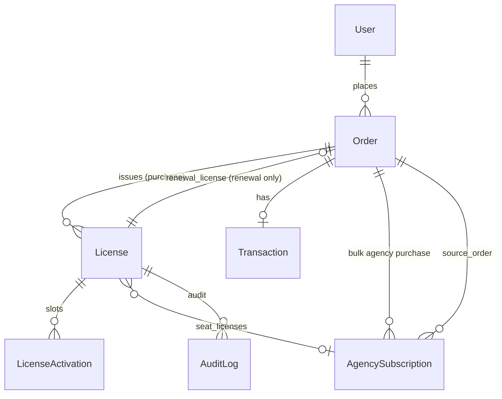

# ممیزی سیستم لایسنس، سفارش، پرداخت و تمدید — Divar Filing

**تاریخ:** ۱۴۰۴/۰۸/۲۱ (۲۰۲۶-۱۱-۱۲)  
**وضعیت:** فاز ۰ — فقط خواندنی (بدون تغییر کد)  
**دامنه:** اپ‌های `shop`, `licenses`, `accounts`, `workspace` (Agency), `mobile_api` (checkout)

---

## ۱. خلاصه ejecutive

| قابلیت | وضعیت فعلی |
|--------|------------|
| خرید فردی + صدور کلید جدید | **موجود و production** |
| خرید آژانسی چندکلیده (`quantity` + `allow_bulk_purchase`) | **موجود** |
| تمدید **تکی** همان کلید (`Order.renewal_license` + `fulfill_renewal_for_paid_order`) | **موجود** (اضافه‌شده migration `0016_order_renewal_license`) |
| تمدید **گروهی/انتخابی** صندلی‌های یک سفارش آژانسی | **وجود ندارد** |
| صفحه جزئیات سفارش با CTA تمدید گروهی | **وجود ندارد** |
| Snapshot مالی per-license برای تمدید | **فقط `AuditLog.details` JSON** |
| همگام‌سازی `AgencySubscription` با تمدید تکی صندلی | **ناهماهنگ** (ریسک عملیاتی) |

معماری فعلی تمدید رسمی را روی **همان مدل `Order`** با یک FK به یک لایسنس پیاده کرده است؛ خرید مجدد آژانس با **سفارش bulk جدید** و `provision_subscription_from_paid_order` انجام می‌شود، نه با انتخاب subset کلیدها.

---

## ۲. نقشه اپ‌ها و مسیرهای URL

```
divar_shop/urls.py
├── shop.urls          → خرید، renew_license، محتوای فروشگاه
├── shop.payment_urls  → checkout، callback زیبال، کارت‌به‌کارت
├── accounts.urls      → dashboard (لایسنس، سفارش، مدیریت صندلی)
├── workspace.urls     → agency hub، CRM آژانس
├── licenses.api_urls  → API دسکتاپ/ربات
└── mobile_api         → create_checkout با renew_license_id
```

| مسیر | نام | نقش |
|------|-----|-----|
| `shop/.../buy/<slug>/` | `buy` | ایجاد سفارش (خرید یا تمدید با `?renew=` ) |
| `shop/licenses/<id>/renew/` | `renew_license` | Redirect به `buy` با پارامترها |
| `payment/checkout/<order_id>/` | `payment:checkout` | پیش‌پرداخت |
| `payment/callback/` | `payment:callback` | verify زیبال → fulfillment |
| `accounts/.../orders/<id>/json/` | `OrderDetailJsonView` | مودال جزئیات سفارش |
| `workspace/crm/agency/licenses/` | `agency_hub_licenses` | استخر صندلی (بدون تمدید) |

---

## ۳. مدل‌های داده (واقعی)

### ۳.۱ `shop.models.Order`

- PK: `UUIDField`
- `user`, `product`, `plan`, `quantity` (تعداد کلید در خرید اولیه)
- مالی: `amount`, `original_price`, `discount_amount`, `discount_code`
- وضعیت: `pending` \| `pending_verification` \| `paid` \| `granted` \| `failed` \| `cancelled`
- `renewal_license` → `licenses.License` (nullable) — **فقط یک لایسنس per سفارش تمدید**
- `paid_at`, `payment_method`, `zibal_track_id`

**رابطه با لایسنس:** خرید جدید → `License.order` = این سفارش. تمدید → کلید **همان** `License` باقی می‌ماند؛ سفارش تمدید فقط از طریق `renewal_license` و `renewal_orders` (reverse FK) قابل ردیابی است.

### ۳.۲ `licenses.models.License`

- `order` (FK, CASCADE), `sequence` (unique با order)
- `license_key` (unique), `plan`, `status`, `max_activations`, `expires_at`
- تخصیص آژانس: `assigned_user`, `assigned_by`, `assigned_at`
- `agency_subscription` → `workspace.AgencySubscription`

انقضا: `sync_expiration_status()` وضعیت را `expired` می‌کند.

### ۳.۳ `shop.models.Transaction`

- OneToOne با `Order`
- audit زیبال: `callback_payload`, `verify_payload`, `paid_amount_rial`, …

### ۳.۴ `workspace.models.AgencySubscription`

- `owner`, `agency`, `source_order` (سفارش **ایجادکننده** اشتراک)
- `seat_count`, `starts_at`, `expires_at`, `status`
- **منبع حقیقت دسترسی مدیریت آژانس** (`agency_entitlement.get_subscription_for_agency`)

### ۳.۵ مدل جداگانه Renewal / OrderItem

**وجود ندارد.** آیتم سفارش = `quantity` عددی روی همان `Order`، نه ردیف per-license برای تمدید.

### ۳.۶ سوابق تمدید

- `licenses.models.AuditLog` با `details.event == 'license_renewed'` و `order_id` در JSON
- **نه** جدول snapshot قیمت per-license

---

## ۴. دیاگرام روابط (خلاصه)



**خرید آژانسی:** یک `Order` با `quantity=N` → N رکورد `License` با `sequence` ۱..N روی **همان** order. پس از پرداخت، `provision_subscription_from_paid_order` اشتراک می‌سازد و `agency_subscription` + `expires_at` یکسان روی کلیدها (و کلیدهای اشتراک قبلی) می‌نشیند.

**تمدید تکی:** `Order` جدید + `renewal_license_id` → بدون کلید جدید؛ `fulfill_renewal_for_paid_order` همان `License` را به‌روز می‌کند.

---

## ۵. جریان خرید (end-to-end)

1. **انتخاب پلن** — `BuyView` / `mobile_api.create_checkout`
2. **قیمت** — `shop.services.plan_pricing.calculate_plan_pricing` (تخفیف bulk آژانس، خرید مجدد، کد تخفیف)
3. **ایجاد `Order`** — `pending`
4. **پرداخت** — زیبال (`PaymentInitiateView` → callback → `verify`) یا کارت‌به‌کارت (`CardTransferView` → `approve_card_transfer`)
5. **Fulfillment مرکزی** — `shop.services.order_fulfillment.fulfill_order_after_payment`:
   - `select_for_update` روی Order؛ idempotent `paid`
   - `finalize_discount_consumption`
   - affiliate
   - `licenses.services.claim.issue_licenses_for_paid_order`
   - اگر پلن آژانس: `workspace.services.agency_entitlement.provision_subscription_from_paid_order`
6. **فعال‌سازی دستگاه** — مسیر جدا: `claim_license_for_order`, API دسکتاپ، `LicenseActivation`

**Idempotency پرداخت:**  
- Order paid دوباره mark نمی‌شود (`fulfill_order_after_payment`)  
- Callback اگر `order.status == paid` redirect موفق (`PaymentCallbackView`)  
- تمدید: `_renewal_already_fulfilled` روی `AuditLog` (`renewal.py`)

**قانون انقضای پس از پرداخت (خرید جدید):** `now + plan.duration_days` (`claim._license_expires_at`)

---

## ۶. جریان تمدید (موجود)

### ۶.۱ ورود UI

- داشبورد لایسنس: لینک `renew_license` وقتی `can_renew` (منقضی یا ≤۷ روز) — `licenses/services/management.build_license_dashboard`
- `RenewLicenseView` → redirect به `buy?renew=&plan=`
- صفحه خرید: بنر تمدید، `quantity` مخفی، `order.renewal_license` در POST
- موبایل: `shop_checkout_service.create_checkout(renew_license_id=...)`

### ۶.۲ مجوز

- `get_renewable_license_for_user`: مالک `order.user`، `order.status=paid`
- `evaluate_license_renewal`: نه suspended، محصول فعال، باید `expires_at` داشته باشد (نامحدود = غیرقابل تمدید)

### ۶.۳ قیمت تمدید

همان `calculate_plan_pricing` با `quantity=1` — تخفیف خرید مجدد (`Product.repeat_purchase_discount`) چون سفارش paid قبلی وجود دارد. **تخفیف bulk آژانس روی تمدید تکی اعمال نمی‌شود** (`allow_bulk_purchase` → qty همیشه ۱ در تمدید).

### ۶.۴ اعمال پس از پرداخت

`fulfill_renewal_for_paid_order` (`licenses/services/renewal.py`):

```text
base = max(now, license.expires_at)
new_expires = base + plan.duration_days
```

- به‌روزرسانی: `plan`, `max_activations`, `expires_at`, `status` (اگر expired → active اگر activation دارد)
- **کلید ثابت**
- AuditLog با previous/new expires

`issue_licenses_for_paid_order` ابتدا renewal را چک می‌کند؛ برای تمدید کلید جدید نمی‌سازد.

### ۶.۵ تمدید آژانس (رفتار فعلی — نه formal renewal per seat گروهی)

وقتی اشتراک آژانس منقضی می‌شود:

- UI: `workspace/crm/agency/locked.html` → لینک خرید پلن آژانس (`agency_buy_url`)
- خرید **جدید** با `allow_bulk_purchase` و `quantity` کامل (حداقل ۲، tier تخفیف حجمی)
- `provision_subscription_from_paid_order`:
  - اشتراک قبلی active → `expires_at` جدید = قبلی + duration
  - غیرفعال → `now + duration`
  - **همه** `License`های سفارش جدید + **همه** کلیدهای `agency_subscription` قبلی → همان `expires_at` و اشتراک جدید

تست: `workspace/tests/test_agency_phase2.py::test_advisor_seat_on_previous_subscription_still_entitled`

**تمدید formal تک‌صندلی** (`renewal_license` روی پلن غیر-bulk یا تک‌کلید آژانس): فقط آن `License` را extend می‌کند؛ **`AgencySubscription.expires_at` به‌روز نمی‌شود.**

---

## ۷. قیمت‌گذاری و تخفیف (منبع حقیقت)

| منبع | فایل |
|------|------|
| محاسبه مرکزی | `shop/services/plan_pricing.py` |
| tier آژانس | `AGENCY_BULK_DISCOUNT_TIERS` (۲→۱۰٪ … ۱۱-۲۵→۲۵٪) |
| bulk vs repeat | **max** — stack نمی‌شوند |
| کد تخفیف روی pending | `shop/services/order_discount.py` |
| مصرف کد پس از paid | `shop/services/discount_consumption.py` |

**محدودیت تمدید آژانسی انتخابی (آینده):** قیمت per-seat باید از `plan_unit_sale_price` × تعداد انتخابی محاسبه شود؛ tier bulk فقط وقتی `quantity` همان سفارش ≥ min آژانس است — برای ۳ از ۵ کلید نیاز به سیاست صریح (per-seat بدون tier یا tier روی count انتخابی).

---

## ۸. فایل‌ها و توابع کلیدی

| حوزه | فایل | توابع/کلاس‌های مؤثر |
|------|------|---------------------|
| تمدید دامنه | `licenses/services/renewal.py` | `evaluate_*`, `compute_renewed_expires_at`, `fulfill_renewal_for_paid_order` |
| صدور/claim | `licenses/services/claim.py` | `issue_licenses_for_paid_order` |
| Fulfillment | `shop/services/order_fulfillment.py` | `fulfill_order_after_payment` |
| پرداخت | `shop/payment_views.py` | callback, `_finalize_successful_payment` |
| خرید وب | `shop/views.py` | `BuyView`, `RenewLicenseView` |
| Checkout موبایل | `mobile_api/services/shop_checkout_service.py` | `create_checkout` |
| آژانس entitlement | `workspace/services/agency_entitlement.py` | `provision_subscription_from_paid_order`, `is_agency_plan_order` |
| صندلی | `workspace/services/agency_seats.py` | assign/list/get_member_seat |
| UI لایسنس | `licenses/services/management.py` | `build_license_dashboard`, `build_agency_license_pool` |
| جزئیات سفارش | `accounts/services/order_detail.py` | `serialize_order_detail` (`is_renewal`) |
| تست تمدید | `licenses/tests/test_renewal.py` | idempotency, expiry stacking |
| تست پرداخت | `shop/tests/test_payment.py` | fulfill idempotent |
| تست آژانس | `workspace/tests/test_agency_phase2.py` | subscription renewal path |

---

## ۹. UI فعلی vs الزامات Super Prompt

| الزام | وضعیت |
|-------|--------|
| کارت سفارش + «تمدید لایسنس‌ها» | فقط لیست سفارش در `account_orders_panel.html`؛ **بدون** CTA تمدید گروهی |
| صفحه جزئیات سفارش آژانسی + انتخاب کلید | **ندارد** |
| تأیید تمدید با preview per-key | فقط در `buy.html` برای **یک** کلید |
| Mask کلید + انتخاب همه/بخشی | hub_licenses نمایش pool؛ بدن تمدید |
| Premium mobile | تمدید از dashboard licenses؛ agency hub جدا |

قالب‌های مرتبط: `templates/shop/buy.html`, `payment_checkout.html`, `payment_success.html`, `accounts/partials/account_licenses_panel.html`

---

## ۱۰. مشکلات، ریسک‌ها و شکاف‌ها

### ۱۰.۱ عملیاتی — تمدید تکی vs اشتراک آژانس

- مدیریت آژانس به `AgencySubscription` وابسته است.
- تمدید formal یک صندلی، اشتراک را تمدید **نمی‌کند** → ممکن است کلید معتبر بماند اما hub قفل (`management_status=locked`).
- خرید bulk مجدد کل اشتراک و همه صندلی‌های قبلی را هم‌زمان extend می‌کند — **دو مدل تمدید متفاوت** بدون مستندسازی محصول.

### ۱۰.۲ محصولی — تمدید انتخابی / یکجا

- `Order.renewal_license` فقط **یک** FK — پشتیبانی چند لایسنس در یک پرداخت نیاز به مدل جدید (مثلاً `OrderRenewalItem`) یا M2M دارد.
- پس از finalize سفارش، لیست licenseها باید immutable باشد (امروز برای تمدید تکی در DB ثبت می‌شود؛ برای multi باید explicit شود).

### ۱۰.۳ مالی / گزارش

- Snapshot قیمت per-license در تمدید گروهی وجود ندارد.
- اتصال «سفارش اصلی» به تمدید: غیرمستقیم (`license.order` = خرید اول؛ تمدیدها = `license.renewal_orders`).

### ۱۰.۴ امنیت (نقاط قوت موجود)

- مالکیت سفارش در payment و renew
- `select_for_update` در fulfillment و renewal
- verify زیبال قبل از paid (نه فقط redirect مرورگر)
- idempotency renewal via AuditLog

### ۱۰.۵ شکاف تست

- تمدید گروهی، concurrent renewal، agency selective — **تست ندارد**
- پرداخت موفق + خطای موقت اعمال تمدید + retry — **پوشش محدود** (idempotency unit test موجود)

### ۱۰.۶ رگرسیون

- خرید bulk، provisioning آژانس، discount، mobile checkout — تست‌های موجود باید پس از تغییرات pass بمانند.

---

## ۱۱. قابلیت‌هایی که باید حفظ شوند

- کلید لایسنس در تمدید تکی **تغییر نمی‌کند**
- `LicenseActivation` و تخصیص `assigned_user` در `fulfill_renewal` دست‌نخورده (فقط plan/expiry/status)
- سفارش اصلی و کلیدهای صادرشده **حذف/بازنویسی نمی‌شوند**
- مسیر `renew_license` + موبایل `renew_license_id`
- قوانین `calculate_plan_pricing` (بدون تغییر خودسرانه)
- `provision_subscription_from_paid_order` برای خرید bulk جدید آژانس
- Analytics: `renewal_license_id` در admin dashboard (`admin_dashboard.py`)

---

## ۱۲. پیشنهاد معماری هدف (فاز ۱+ — برای پیاده‌سازی)

### ۱۲.۱ تفکیک مفاهیم (هم‌راستا با کد فعلی)

| مفهوم | پیاده‌سازی پیشنهادی |
|--------|---------------------|
| Order | همان `Order` برای هر عملیات مالی (خرید یا تمدید) |
| License | همان موجود |
| Agency entitlement | همان `AgencySubscription` + `agency_subscription` روی License |
| Renewal | سفارش با `order_type=renewal` (اختیاری) یا تشخیص از وجود آیتم‌های تمدید |
| Payment | همان `Transaction` |

### ۱۲.۲ مدل additive پیشنهادی: `OrderRenewalItem`

فیلدهای پیشنهادی (migration additive):

- `order` (FK)
- `license` (FK, PROTECT)
- `unit_original_price`, `unit_discount_amount`, `unit_final_price` (Decimal snapshot)
- `previous_expires_at`, `new_expires_at` (nullable تا قبل از apply)
- `applied_at` (null = pending apply)
- `apply_error` (برای reconciliation)
- Unique: `(order, license)` برای جلوگیری از duplicate در یک سفارش

**سازگاری عقب‌رو:** اگر فقط `renewal_license` ست باشد و هیچ item نباشد → همان مسیر فعلی.

### ۱۲.۳ سرویس مرکزی: گسترش `licenses/services/renewal.py`

- `build_renewal_quote(user, license_ids[], plan)` → قیمت server-side
- `create_renewal_order(...)` → Order + items، quantity = len(license_ids)
- `fulfill_renewal_for_paid_order` → حلقه atomic روی items با `select_for_update` per license
- Idempotency: per `(order_id, license_id)` در AuditLog یا `applied_at` روی item

### ۱۲.۴ سیاست آژانس (نیاز تصمیم محصول — قبل از کد)

گزینه‌ها:

1. **تمدید صندلی** فقط کلید را extend کند؛ برای hub باید **اشتراک** جدا تمدید شود (وضعیت فعلی تقریباً همین است اما UX گمراه‌کننده است).
2. تمدید هر صندلی آژانس، `AgencySubscription.expires_at` را به `max(sub, license)` ببرد (اگر همه صندلی‌ها renew شوند).
3. تمدید گروهی آژانس همیشه از مسیر bulk + `provision_subscription` (quantity = تعداد انتخابی) و قیمت tier روی count انتخابی.

**توصیه فنی:** برای «تمدید انتخابی با یک پرداخت»، گزینه ۳ با `provision_subscription` فقط وقتی **همه** صندلی‌های اشتراک انتخاب شوند؛ وگرنه گزینه ۲ با cap همگام‌سازی subscription — **باید با محصول نهایی شود.**

### ۱۲.۵ UI

- صفحه/مودال جدید: `accounts` یا `workspace` — «تمدید از سفارش `<uuid>`» با لیست `License` های `order.licenses`
- اتصال از `account_orders_panel` برای سفارش‌های `paid` با چند کلید
- استایل: همان OV2 dashboard + workspace agency tokens (بدون زبان بصری جدید)

### ۱۲.۶ Database safety

- فقط `AddField` / `CreateModel` / indexes
- بدون drop `renewal_license`
- backfill: optional script برای تبدیل renewalهای قدیمی به items (idempotent)

---

## ۱۳. Acceptance gap (نسبت به Super Prompt)

| معیار | پس از ممیزی |
|-------|-------------|
| تمدید فردی | ✅ موجود |
| تمدید همه/بخشی آژانس یکجا | ❌ |
| سوابق مالی مستقل per license | ⚠️ جزئی (AuditLog) |
| UI premium سفارش/جزئیات تمدید | ❌ ناقص |
| تست‌های سناریو گروهی | ❌ |

---

## ۱۴. گام‌های بعدی پیشنهادی (فاز ۱–۸)

1. تثبیت **سیاست آژانس** (بند ۱۲.۴) با مالک محصول.
2. Migration `OrderRenewalItem` + flags اختیاری روی Order.
3. گسترش `renewal.py` + اتصال `BuyView` / endpoint جدید agency bulk renew.
4. Pricing: `calculate_plan_pricing` با `quantity=len(selected)` برای پلن bulk.
5. UI dashboard + workspace (RTL, mobile-first).
6. تست‌های فاز ۷ Super Prompt.
7. مستند deploy/rollback در `docs/deploy.md` یا appendix.

---

## ۱۵. منابع کد (ارجاع سریع)

- مدل Order + renewal FK: `shop/models.py` (~L280-322)
- Renewal engine: `licenses/services/renewal.py`
- Claim/fulfill branch: `licenses/services/claim.py` (~L20-34)
- Agency provision: `workspace/services/agency_entitlement.py` (~L251-323)
- Migration renewal: `shop/migrations/0016_order_renewal_license.py`

---

*این سند خروجی فاز ۰ است. پیاده‌سازی تا تأیید این ممیزی و (در صورت نیاز) تصمیم سیاست آژانس شروع نشده است.*
